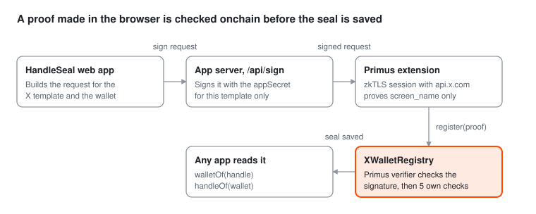

<p align="center"></p>

# HandleSeal

HandleSeal lets anyone prove they own an X account with a [Primus](https://primuslabs.xyz) zkTLS proof and seal
that handle to their wallet onchain. It is live on BNB Smart Chain Testnet, open source, and the first real seal is
already onchain.

Anyone can type an X handle next to a wallet. HandleSeal makes that claim checkable by any app, for example to
stop fake accounts in a giveaway or to send funds to an X handle. No password and no OAuth app are involved.

HandleSeal is a community project built on Primus zkTLS. Not an official Primus product.

| Item | Link |
| --- | --- |
| Live app | [handleseal.vercel.app](https://handleseal.vercel.app) |
| Registry contract | [`0x60D230207363dbE9F008a7460eDeD2984Fb4e320`](https://testnet.bscscan.com/address/0x60D230207363dbE9F008a7460eDeD2984Fb4e320) on BNB Smart Chain Testnet |
| Primus verifier copy | [`0x980201a11a460bE5213d75b708200C9A79BEf35B`](https://testnet.bscscan.com/address/0x980201a11a460bE5213d75b708200C9A79BEf35B), same network |
| First real seal | [Transaction 0x9041...17c6](https://testnet.bscscan.com/tx/0x90418627a7a5faea73db3c34ce6fa7fb36bbe78ae36c59c0191569967d4917c6) |
| Primus pieces used | `@primuslabs/zktls-js-sdk` 0.3.15, `@primuslabs/zktls-contracts` 0.1.0, the X Account Ownership template |

## How it uses Primus

<picture>
  <source media="(prefers-color-scheme: dark)" srcset="docs/how-it-uses-primus-dark.svg">
  
</picture>

The app uses the zkTLS JS SDK in `proxytls` mode with the public X Account Ownership template
(`2e3160ae-8b1e-45e3-8c59-426366278b9d`). The `appSecret` never reaches the browser: the server signs only
requests for its own appId, this template and a real wallet address.

## What the contract checks

The Primus verifier only checks that a trusted attestor signed the attestation, so `XWalletRegistry` adds five
checks of its own before it saves a seal.

| Check | Stops |
| --- | --- |
| Signed by a trusted Primus attestor (through `IPrimusZKTLS.verifyAttestation`) | forged or edited proofs |
| `recipient` equals the wallet sending the transaction | someone reusing another wallet's proof |
| Proof is at most 1 hour old, with 5 minutes of clock drift allowed | old proofs replayed later |
| Request URL is `api.x.com/1.1/account/settings.json` and the only field is `$.screen_name` | proofs from other templates or sites |
| Handle is 1 to 15 characters of `A-Z a-z 0-9 _` | hashed or malformed values |
| Proof is newer than the last accepted one for that handle | a previous owner taking a handle back after it changed hands |

Handles are matched without case. The contract also keeps a count of active seals and a list of recent ones, which
the site reads directly.

## Live proof

The first seal is a real Primus zkTLS attestation, made in the browser on the live site and accepted by the
contract in [transaction 0x9041...17c6](https://testnet.bscscan.com/tx/0x90418627a7a5faea73db3c34ce6fa7fb36bbe78ae36c59c0191569967d4917c6)
(block 142115701, 247,797 gas). What the attestation in that transaction carries:

| Field | Value |
| --- | --- |
| Data source | `GET api.x.com/1.1/account/settings.json` |
| Request header and body | empty, so no cookies or session data go onchain |
| Revealed data | `screen_name` only, with condition `REVEAL_STRING` |
| Attestor | `0x5Ed3176045F68617B0958a61ac1868875C98C14d` |
| Recipient | the sealing wallet, checked by the contract |

## Tests

All three suites pass, and the contract tests run against the real Primus verifier code from
`@primuslabs/zktls-contracts`.

| Suite | Command | What it shows |
| --- | --- | --- |
| Contract tests, 20 cases | `npm run test:contracts` | every check above, relinking, unlink, recent seals |
| End to end on Anvil | `npm run test:e2e` | the SDK's own `encodeAttestation` hash equals the onchain hash, and `register` works with the web app's ABI |
| Server signing | `npm run test:sign` | the server's request signing is byte for byte the same as `PrimusZKTLS.sign()` |

## Run it locally

Needs Node 22.9+, [Foundry](https://book.getfoundry.sh/getting-started/installation), Chrome with the
[Primus extension](https://chromewebstore.google.com/detail/pado/oeiomhmbaapihbilkfkhmlajkeegnjhe) and a
browser wallet.

```bash
npm install
cp .env.example .env   # add PRIMUS_APP_ID and PRIMUS_APP_SECRET from a DApp project in the Primus Developer Hub
npm run dev            # local chain, contracts, API and web app on http://localhost:5173
```

## An issue I ran into

While building HandleSeal I could not get attestations from `@primuslabs/zktls-js-sdk` 0.3.15 to verify onchain
on any of the testnets I tried, while the same attestation does verify on BNB Chain mainnet. I may be missing a
step, so I am sharing what I saw in case it helps.

From what I can tell, the SDK checks attestations against attestor `0x5Ed3176045F68617B0958a61ac1868875C98C14d`
(`PADOADDRESSMAP.production` in `dist/config/constants.js`), while the testnet verifiers I read only list
`0xDB736B13E2f522dBE18B2015d0291E4b193D8eF6`. The SDK's development attestor,
`0xe02bd7a6c8aa401189aebb5bad755c2610940a73`, is not listed on the BNB Chain Testnet verifier either.

My guess is that the attestor changed in the SDK: versions 0.2.0 to 0.3.14 (published up to May 9, 2026) use
`0xDB73...`, and 0.3.15 (published Oct 14, 2026) uses `0x5Ed3...`. The mainnet verifier seems to have been updated
and the testnet ones not, but I may be wrong about the cause. These are the results of `verifyAttestation` through
`eth_call` with the real attestation from the transaction above, checked on Nov 11, 2026:

| Network | Verifier | Result |
| --- | --- | --- |
| BNB Chain mainnet | `0xF3C20A5216d669C521ffe3724C1439aE0897aC33` | accepted |
| BNB Chain Testnet | `0xBc074EbE6D39A97Fb35726832300a950e2D94324` | `Invalid signature` |
| BNB Chain Testnet, from the contracts repo broadcast files | `0x4620362a803f82b7231b18e09abc5d400a7891fb` | `Invalid signature` |
| Sepolia, opBNB Testnet | `0x3760aB354507a29a9F5c65A66C74353fd86393FA` | `Invalid signature` |
| Base Sepolia, Unichain Sepolia, X Layer Testnet | `0xCE7cefB3B5A7eB44B59F60327A53c9Ce53B0afdE` | `Invalid signature` |
| Monad Testnet | `0x1Ad7fD53206fDc3979C672C0466A1c48AF47B431` | no contract code at this address |

Two smaller things I noticed in the docs:

- The [Supported Networks](https://docs.primuslabs.xyz/enterprise/zk-tls-sdk/solidity/support) page lists
  `0x0000` for every network, while the
  [Onchain Interaction](https://docs.primuslabs.xyz/enterprise/onchain-interaction/overview) page has the real
  addresses.
- The `zktls-contracts` README links to `docs.primuslabs.xyz/data-verification/zk-tls-sdk/solidity/overview`,
  which now returns Page Not Found.

To keep building, HandleSeal deploys its own copy of the Primus verifier code on testnets, trusting only the SDK
attestor (`0x980201a11a460bE5213d75b708200C9A79BEf35B` on BNB Chain Testnet), and uses the official verifier on
BNB Chain mainnet. If there is a recommended way to verify on testnets, I would be glad to switch to it.

## License

MIT
